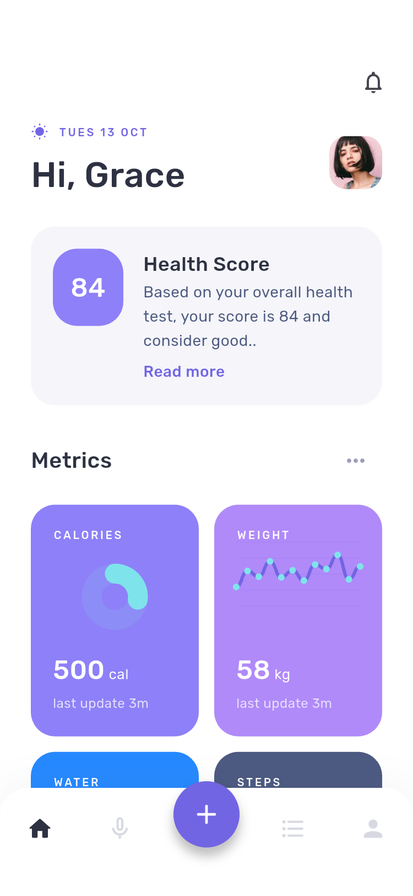
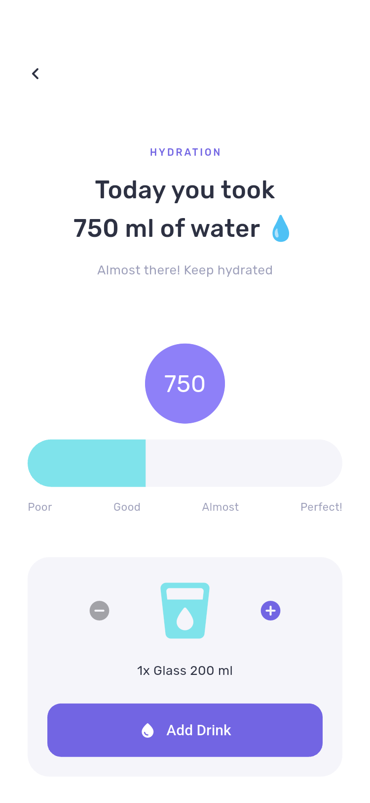
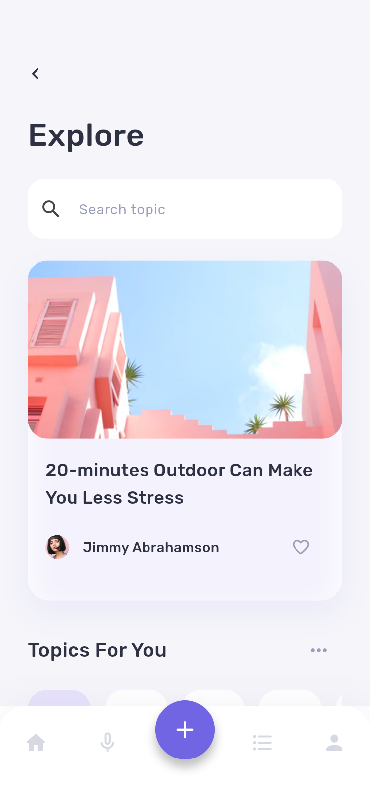

# Momotaro · Flutter 健康生活 App

根据 Pixso「🙌 Momotaro」中的 **43 个产品界面**实现，保留紫色、薄荷色的视觉体系、Rubik 字体和原始插画。包含新手引导、健康记录、播客、探索、社区和个人中心。

| 首页 | 饮水记录 | 内容探索 |
| --- | --- | --- |
|  |  |  |

- [项目说明、结构架构及主要界面](docs/项目说明.md)
- [43 个界面的设计对应关系与截图](docs/页面清单.md)
- [验证记录](docs/验证记录.md)
- [Android ARM64 安装包](dist/Momotaro-android-arm64.apk)

## 运行

```sh
flutter pub get
flutter run
```

首次进入欢迎与引导流程，完成后进入首页。也可以从首页底部 **＋ → All pages** 浏览全部界面。手机验证使用本地演示码 `2828`，密码要求至少 8 位，含大写字母、数字和符号。密码不会被保存。

```sh
flutter analyze
flutter test
flutter drive --driver=test_driver/screenshots.dart \
  --target=integration_test/screenshots_test.dart -d <设备ID>
flutter build apk --release --target-platform android-arm64
```

截图脚本会覆盖 `docs/screenshots/` 下的图片。运行截图测试使用独立的样例数据，不会写入正常使用时的健康记录。

本项目交付的是可交互、可离线保存记录的 UI App。短信、真实身份认证、指纹认证、音频源、系统推送、服务端社区和商店支付未接入；详见项目说明。
