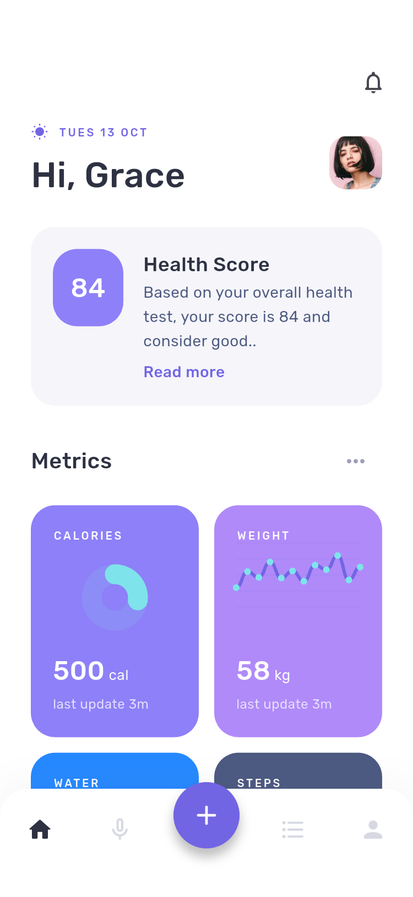
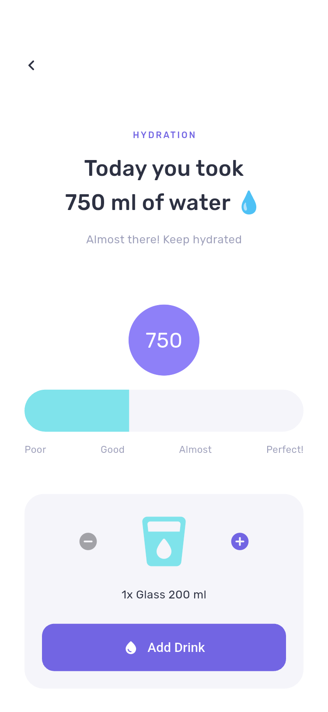
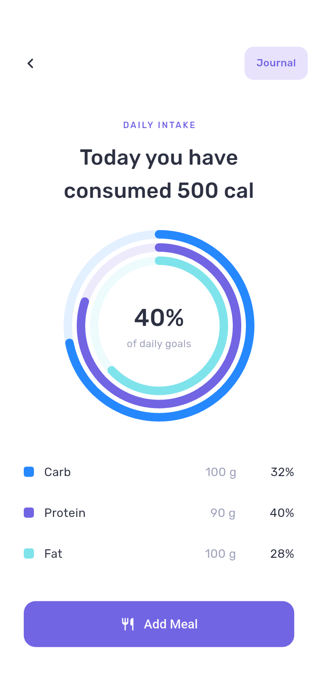
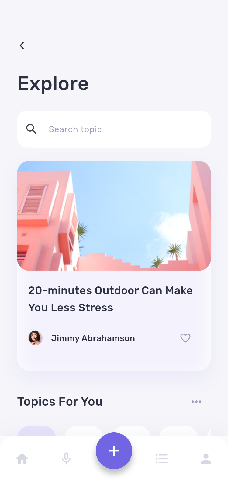
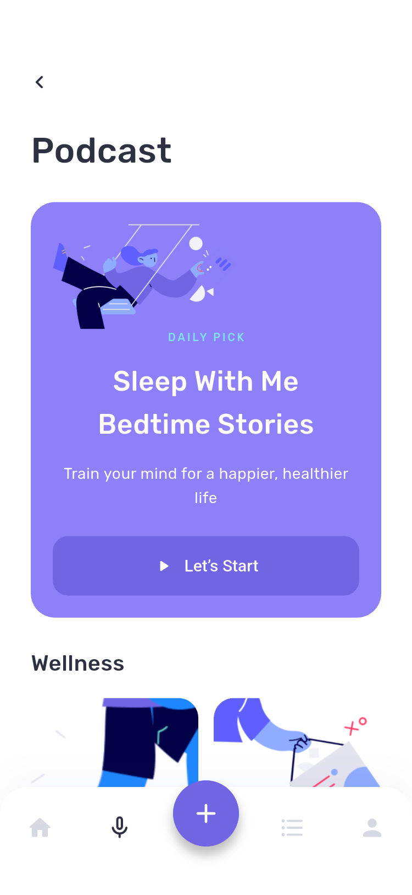
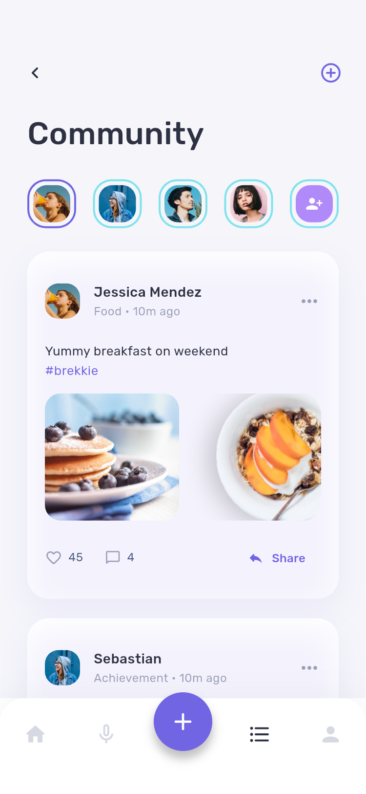
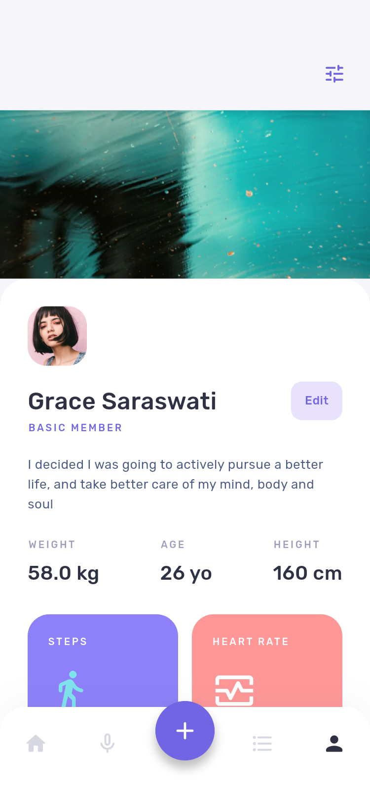
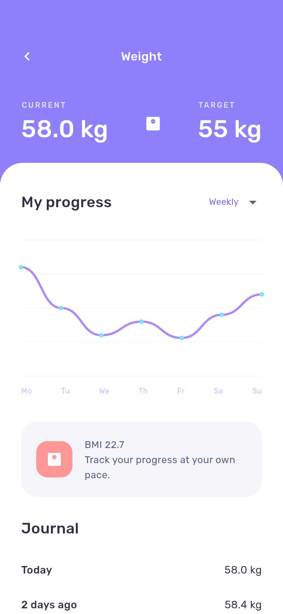
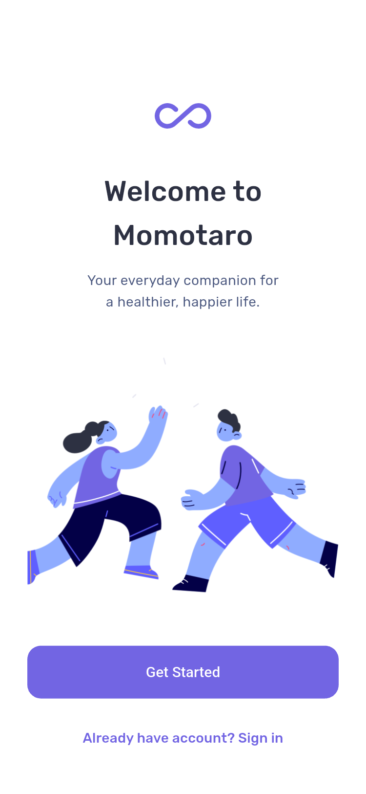

# Momotaro 项目说明

## 项目内容

Momotaro 是使用 Flutter 开发的健康生活 App，依据 Pixso 中的页面、组件、原始文案与插画实现。主要功能包括每日健康概览、饮水与饮食记录、体重趋势、提醒设置、健康内容、播客、运动挑战、活动及社区。

设计来源分为两个页面分类：

| Pixso 分类 | ID | 用途 |
| --- | --- | --- |
| 🙌 Momotaro | `0:1` | 43 个产品界面和 1 个组件展示画板 |
| Symbols | `0:2588` | 复用组件素材，不作为产品界面 |

特别处理了两个同名 `Momotaro-notification`：`0:1746` 为新手引导中的通知授权偏好，`0:1932` 为通知列表。完整映射见[页面清单](页面清单.md)。

## 主要界面

以下均为 Flutter App 的 Android 模拟器运行截图。长页面的下半部分另存为 `-more.png`，可在页面清单中查看。

### 每日健康与饮水

| 首页 | 饮水记录 | 营养概览 |
| --- | --- | --- |
|  |  |  |

首页展示健康评分和四项指标。饮水页可调整杯数并添加记录；营养页可进入食谱与日志，添加食物后会更新累计热量。

### 内容探索与社区

| 探索 | 播客 | 社区 |
| --- | --- | --- |
|  |  |  |

探索页支持搜索、主题筛选与收藏；播客包括详情、会话、播放器及歌单分享。社区包括动态发布、点赞、健康投票、评论与活动入口。

### 个人中心与入门

| 个人中心 | 体重趋势 | 欢迎页 |
| --- | --- | --- |
|  |  |  |

## 项目结构

```text
MomotaroV2/
├── lib/
│   ├── main.dart                 # 启动、页面壳、底部导航、快捷操作、全页面目录
│   ├── core/
│   │   ├── routes.dart           # 43 个类型化页面、命名路由与 Pixso 节点映射
│   │   ├── model.dart            # 共享状态、记录校验与本地持久化
│   │   ├── theme.dart            # 颜色、Rubik 字体、按钮和输入框样式
│   │   └── widgets.dart          # 卡片、标题、图片、头像、图表、入口等通用组件
│   └── features/
│       ├── onboarding.dart       # 欢迎、账号表单、个人偏好及入门流程
│       ├── health.dart           # 指标、饮水、营养、食谱、体重与提醒
│       ├── content.dart          # 探索、播客、挑战、活动与贴士
│       └── social.dart           # 社区、个人主页、会员、邀请与反馈
├── assets/
│   ├── images/                   # 从 Pixso 导出的原始插画、照片和头像
│   └── fonts/                    # Rubik 可变字体与 OFL 许可
├── test/app_test.dart            # 数据恢复、输入校验、两种屏宽的页面检查
├── integration_test/             # Android 真机/模拟器交互与逐页截图
├── test_driver/                  # 将设备截图保存到项目
├── docs/
│   ├── 项目说明.md
│   ├── 页面清单.md
│   ├── 验证记录.md
│   └── screenshots/              # 每页截图及长页面补充截图
├── android/                      # Android 宿主
├── ios/                          # iOS 宿主
├── macos/                        # macOS 宿主
├── pubspec.yaml
└── README.md
```

## 架构与数据流

采用适合当前规模的功能模块划分，页面共用主题和基础组件。没有额外引入路由、状态管理或图表框架；业务运行时除 Flutter 外只依赖 `shared_preferences`。

```text
页面与交互（features）
         ↓ 调用
AppModel（ChangeNotifier）
         ↓ 校验并保存
SharedPreferences（momotaro.v1 JSON）
         ↓ 状态通知
AppScope（InheritedNotifier）
         ↓ 重建使用到该状态的页面
首页 / 日志 / 个人资料等
```

- **页面路由**：`Screen` 枚举集中声明名称、中文含义、路由与设计节点。各模块按枚举构建具体页面。
- **导航**：首页、播客、社区、个人中心组成底部主导航；中央加号打开快捷操作。All pages 提供所有页面的统一浏览入口。
- **共享状态**：饮水、体重、饮食日志、姓名、头像、入门完成状态、兴趣、目标、收藏、投票、动态、提醒偏好与活动加入状态由 `AppModel` 管理。
- **页面内状态**：搜索词、图表周期、播放器位置、评论草稿、评分和临时选项保留在对应页面的 `State` 中，离开页面可释放。
- **本地存储**：有效记录保存后会在下一次启动时读取。体重限定为 20–350 kg，并拒绝无穷值与非数字；最近保留 30 条体重记录。
- **资源**：主色 `#7265E3`，卡片紫色 `#8E80F8`，薄荷色 `#7FE3EB`。插画与照片使用项目内资源，页面加载不依赖远程图片。
- **图表**：环形、趋势线与柱形图使用 `CustomPainter` 绘制。历史步数和趋势曲线是演示数据，体重日志及当前体重会随输入更新。

## 可用的交互

| 模块 | 交互及结果 |
| --- | --- |
| 新手引导 | 手机格式与验证码校验、密码规则、头像、兴趣、目标、性别、运动等级、体重和通知偏好；完成状态持久化 |
| 健康 | 添加饮水、查看步数周期、保存体重、调整份数添加饮食日志、更新累计热量 |
| 提醒 | 选择睡眠时间、提醒偏好和每周称重日期并保存 |
| 内容 | 搜索与筛选、收藏、作者关注、会话切换、播放进度控制、歌单复制 |
| 社区 | 本地发布动态、临时点赞与评论、保存投票、切换分享卡片并复制分享文字 |
| 活动 | 查看活动资料、地图参考图、保存本地预约状态 |
| 个人 | 修改姓名、切换头像、查看徽章、复制邀请码、选择会员方案、保存反馈 |

## 接口接入范围

本次实现以完整 UI、导航和本地交互为范围，没有外部服务凭据：

- 手机验证为固定演示码 `2828`；不会实际发送短信或创建远程账号。密码只用于当前页面校验，不写入本地存储。
- 指纹页面保存的是演示流程中的选择，不调用系统生物认证。通知与提醒保存为 App 内偏好，没有安排系统通知。
- 播放器提供播放/暂停状态、计时与进度交互，没有附带音频文件；离线开关保存当前页面偏好，没有实际音频下载。
- 社区数据保存在本机。评论、点赞、关注等页面临时状态不会同步到服务端；邀请奖励和徽章为设计样例。
- 会员与活动付款入口展示预览说明，不发起扣款。真实支付需要接入商店或付款服务。
- 地图为设计资源的静态图，没有定位权限或导航服务。
- 保留英文设计文案，说明文档使用中文；未加入多语言切换。

## 适配与代码整理

以设计稿的 375 宽度为基准，使用可滚动布局、弹性宽度和可换行按钮适配较小屏幕。桌面端将内容宽度限制为 520，避免移动界面在大窗口中拉伸。

重复的按钮、卡片、文字层级、头像、图表、列表入口和页面容器集中在 `core` 中；业务按四个功能文件划分，避免 43 个重复脚手架。没有保留 Pixso 自动转换产生的绝对定位代码，也没有整页截图充当 App 界面。

删除了 Flutter 默认计数器示例和示例测试。每个页面通过统一路由构建，保留完整检查和截图脚本，便于后续修改设计后重新验证。

## 开发与复现

```sh
flutter pub get
flutter run
flutter analyze
flutter test
```

重新生成截图：

```sh
flutter drive --driver=test_driver/screenshots.dart \
  --target=integration_test/screenshots_test.dart -d <Android设备ID>
```

构建 Android ARM64 安装包：

```sh
flutter build apk --release --target-platform android-arm64
```

iOS 与 macOS 宿主已生成，未在本次设备环境中完成构建验证。Android 的实际构建、测试结果和截图环境见[验证记录](验证记录.md)。
